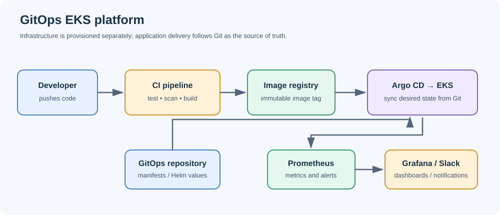
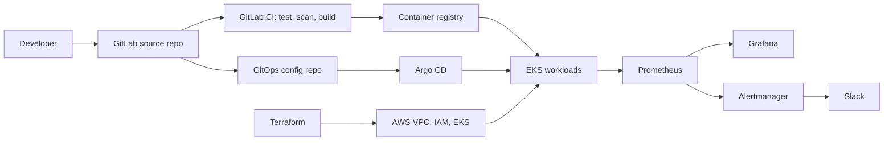

# 1. Full GitOps EKS Platform

A portfolio project demonstrating Infrastructure as Code, CI, GitOps delivery, Kubernetes operations, and observability on AWS.

> **Project status:** Reference implementation / build guide. Replace example values and add screenshots, pipeline links, measured metrics, and deployment evidence as you implement it. Do not claim production deployment or performance results until verified.

## Objectives

- Provision an Amazon EKS cluster, VPC, subnets, IAM roles, and supporting resources with Terraform.
- Build, test, scan, and publish a container image through GitLab CI.
- Deploy Kubernetes manifests or Helm releases through Argo CD.
- Monitor workloads and cluster health with Prometheus and Grafana.
- Route actionable alerts to Slack.

## Architecture





## Technology stack

- AWS: VPC, EKS, IAM, ECR, CloudWatch (optional)
- Terraform: modules, remote state, environment configuration
- GitLab CI/CD: lint, test, image build, vulnerability scan
- Docker, Kubernetes, Helm
- Argo CD: declarative continuous delivery
- Prometheus, Grafana, Alertmanager, Slack webhook

## Suggested repository layout

```text
gitops-eks-platform/
├── infra/
│   ├── modules/{vpc,eks,iam}/
│   └── environments/{dev,staging,prod}/
├── app/
│   ├── Dockerfile
│   └── src/
├── gitops/
│   ├── applications/
│   └── charts/
├── .gitlab-ci.yml
├── docs/
│   ├── architecture.md
│   └── runbook.md
└── README.md
```

The starter files in this directory include a small Flask app, tests, a non-root container, Kubernetes base manifests, an Argo CD Application template, and a test-only GitHub Actions workflow. The Argo CD repo URL is a placeholder; image publishing and AWS provisioning are intentionally not enabled.

### Run the sample application locally

From this directory in PowerShell:

```powershell
py -m venv .venv
.\.venv\Scripts\Activate.ps1
python -m pip install -r app\requirements.txt pytest
python -m pytest -q app
python app\app.py
```

In another terminal, open `http://127.0.0.1:8080/health`. To build the container, run `docker build -t sample-api:dev app`; the Kubernetes image reference is a local placeholder and must be replaced with an image available to your cluster.

## Implementation plan

1. Create an AWS account budget and least-privilege deployment identity.
2. Build reusable Terraform modules for networking, EKS, IAM, and ECR.
3. Configure remote Terraform state and state locking before team use.
4. Provision private worker nodes and restrict cluster/API access.
5. Containerize a small sample application and add health/readiness endpoints.
6. Add GitLab CI stages: format, validate, test, scan, build, push.
7. Keep Kubernetes desired state in a GitOps repository; configure Argo CD to sync it.
8. Install Prometheus/Grafana/Alertmanager using Helm and configure Slack notifications.
9. Test failed deployment, rollback, pod restart, and alert delivery.
10. Document teardown and cost controls.

## Step-by-step build guide

Work in a disposable AWS account or sandbox. EKS, NAT gateways, load balancers, and persistent storage can continue to cost money after a test. Set a budget and teardown owner before provisioning.

### Milestone 1: Prepare the application and repository

1. Create the implementation repository using the suggested layout.
2. Pick a small stateless sample app. Add a health endpoint, a readiness endpoint, and a unit test.
3. Build and run the container locally; verify the health endpoint and document the exact commands.
4. Add `.gitignore` entries for Terraform state, local variables, kubeconfig files, and generated artifacts. Store no credentials in the repository.

**Checkpoint:** A fresh clone can run the app tests and container locally using documented commands.

### Milestone 2: Provision the minimum infrastructure

1. Create and secure the remote Terraform state backend before using it for shared work.
2. Implement and validate the VPC and EKS configuration in small increments; review every plan before applying.
3. Start with one low-capacity non-production node group and private worker nodes. Restrict cluster access to your trusted identity/network.
4. Configure kubectl access and verify cluster/node status. Record Terraform and Kubernetes versions.

**Checkpoint:** The cluster is reachable only through the intended identity, and the Terraform plan has been reviewed and applied successfully.

### Milestone 3: Add continuous integration

1. Add pipeline stages for Terraform formatting/validation and application tests.
2. Add image scanning and build an image tagged with an immutable commit SHA.
3. Push to a registry using the CI platform's supported identity mechanism; do not print credentials.
4. Confirm a deliberately failing test or validation step makes the pipeline fail.

**Checkpoint:** A commit produces a tested, scanned image and the pipeline rejects a failing check.

### Milestone 4: Deploy with GitOps

1. Add Kubernetes manifests or a Helm chart to the GitOps configuration.
2. Install Argo CD with restricted access and connect it to the configuration repository.
3. Deploy the app, then change its image through a Git commit rather than an ad-hoc kubectl edit.
4. Verify the app becomes Synced/Healthy and test a rollback by reverting the Git change.

**Checkpoint:** Git is the source of truth for the deployed version, and a revert restores the previous version.

### Milestone 5: Observe, alert, and clean up

1. Install Prometheus, Grafana, and Alertmanager using pinned chart versions and documented values.
2. Confirm application and cluster metrics are present before building dashboards or alerts.
3. Send a test alert to Slack using a secret-managed webhook; verify delivery without exposing the URL in logs.
4. Test pod recovery, a failed deployment, and alert delivery. Record results and teardown steps.
5. Destroy disposable infrastructure after reviewing the destroy plan; check for leftover load balancers, NAT gateways, disks, and registry artifacts.

**Completion evidence:** Pipeline run, sanitized Terraform plan summary, Argo CD status, dashboard, alert test, rollback test, and exact cleanup procedure.

## Example CI stages

```yaml
stages:
  - validate
  - test
  - security
  - build

terraform_validate:
  stage: validate
  script:
    - terraform -chdir=infra fmt -check -recursive
    - terraform -chdir=infra init -backend=false
    - terraform -chdir=infra validate

app_test:
  stage: test
  script:
    - echo "Replace with application test command"

container_scan:
  stage: security
  script:
    - trivy fs --exit-code 1 --severity HIGH,CRITICAL .

image_build:
  stage: build
  script:
    - docker build -t "$CI_REGISTRY_IMAGE:$CI_COMMIT_SHA" app/
    - docker push "$CI_REGISTRY_IMAGE:$CI_COMMIT_SHA"
```

Configure registry authentication and a Docker-in-Docker or rootless build strategy appropriate to your GitLab runner. Never store credentials in the repository.

## Validation checklist

- [ ] Terraform plan reviewed before apply; no public worker nodes unless justified.
- [ ] EKS access uses IAM/RBAC least privilege.
- [ ] CI fails on formatting, tests, and selected security findings.
- [ ] Argo CD reports the intended application as Synced and Healthy.
- [ ] A Git commit changes the deployed application through GitOps.
- [ ] Grafana dashboards show cluster and workload metrics.
- [ ] Alertmanager sends a test alert to Slack.
- [ ] Rollback procedure is tested and documented.
- [ ] Resources are destroyed after practice to avoid unexpected charges.

## Metrics to publish

Record actual values from repeatable tests; do not invent them.

| Metric | How to measure |
|---|---|
| Deployment frequency | Successful production-like deployments per day/week |
| Lead time for change | Commit timestamp to healthy deployment timestamp |
| Change failure rate | Failed deployments / total deployments |
| MTTR / rollback time | Incident or failed release start to recovery |
| Cluster utilization | CPU and memory requests/usage from Prometheus |

## Security and cost notes

Use private subnets, scoped IAM roles, encrypted state, secret references, image scanning, and pinned action/tool versions. EKS, NAT gateways, load balancers, EBS, and data transfer can incur charges. Use a budget, small practice node groups, and a teardown checklist.

## Evidence to add

Add a real architecture diagram, Terraform plan summary, successful GitLab pipeline screenshot, Argo CD application screenshot, Grafana dashboard screenshot, and measured DORA-style metrics.

## Cleanup

Run `terraform destroy` only from the intended environment and after confirming the plan. Remove leftover load balancers, EBS volumes, NAT gateways, ECR images, and remote-state resources only when safe.
