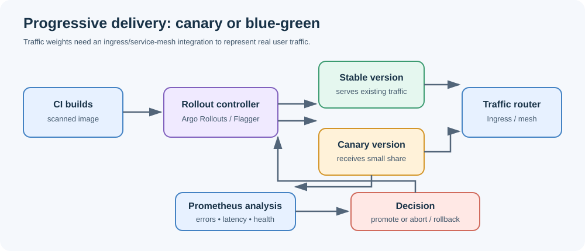
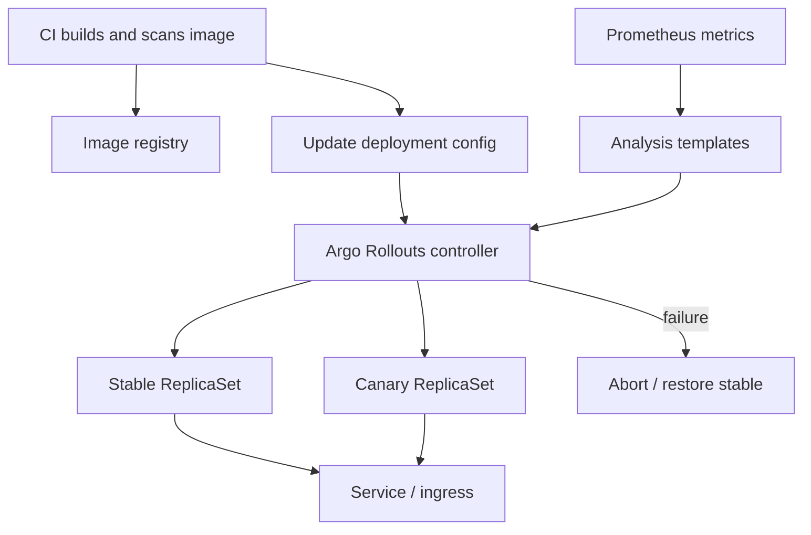

# 2. Zero-Downtime Blue-Green / Canary Deployment Pipeline

A progressive-delivery project that shifts traffic gradually, checks application health, and automatically aborts or rolls back an unhealthy release.

> **Project status:** Implementation blueprint. Add measured downtime, rollout duration, and rollback results only after running controlled tests.

## Objectives

- Deploy two application versions (blue/green) or gradually expose a canary.
- Use Argo Rollouts on EKS or Flagger with a supported ingress/service mesh.
- Evaluate Prometheus metrics and Kubernetes health checks during rollout.
- Abort promotion and restore stable traffic when analysis fails.

## Architecture





## Technology stack

- AWS EKS or ECS (choose one deployment target for the first version)
- Kubernetes Deployment/Service, Argo Rollouts or Flagger
- Prometheus metrics, ingress controller or service mesh
- GitHub Actions or GitLab CI, Docker, container registry

## Suggested repository layout

```text
progressive-delivery/
├── app/
├── k8s/
│   ├── rollout.yaml
│   ├── service.yaml
│   └── analysis-template.yaml
├── monitoring/
├── .github/workflows/
├── docs/
│   └── rollback-runbook.md
└── README.md
```

The `k8s/blue-green/` folder contains a manual-promotion Argo Rollouts starter with active and preview Services. It requires the Argo Rollouts CRDs/controller. The sample uses nginx and demonstrates blue-green promotion only; it is not wired to real user traffic or Prometheus analysis.

The starter deliberately requires manual promotion (`autoPromotionEnabled: false`) and creates no public ingress or cloud resources. For a test cluster with the Rollouts controller installed, apply it and inspect the preview before promoting:

```bash
kubectl apply -k k8s/blue-green
kubectl argo rollouts get rollout sample-api --watch
kubectl argo rollouts promote sample-api
```

## Rollout strategy

**Canary example:** 10% traffic → observe → 25% → observe → 50% → observe → 100%. Use short observation windows in a lab and longer windows for realistic services. Define a stable baseline and meaningful thresholds before promotion.

**Blue-green example:** Deploy green beside blue, run smoke tests against green, switch the service/route, observe, and retain blue briefly for fast rollback.

## Example Argo Rollouts manifest

```yaml
apiVersion: argoproj.io/v1alpha1
kind: Rollout
metadata:
  name: sample-api
spec:
  replicas: 4
  selector:
    matchLabels:
      app: sample-api
  template:
    metadata:
      labels:
        app: sample-api
    spec:
      containers:
        - name: app
          image: nginx:1.27
          ports:
            - containerPort: 80
          readinessProbe:
            httpGet:
              path: /
              port: 80
            initialDelaySeconds: 3
            periodSeconds: 5
  strategy:
    canary:
      steps:
        - setWeight: 10
        - pause: {duration: 30}
        - setWeight: 25
        - pause: {duration: 60}
        - setWeight: 50
        - pause: {duration: 60}
```

This is a learning manifest. Configure traffic routing and metric analysis for your chosen ingress/service mesh before treating weights as real traffic percentages.

## Implementation steps

1. Deploy a sample stateless application with readiness and liveness probes.
2. Install Argo Rollouts and its kubectl plugin.
3. Create stable/canary Services and configure traffic routing.
4. Add CI to build, scan, and publish immutable image tags.
5. Update the rollout image through GitOps.
6. Add Prometheus analysis for request success rate, latency, and error rate.
7. Inject a controlled failure (bad endpoint or elevated error response).
8. Confirm rollout pauses/aborts and stable traffic remains available.
9. Test manual promotion and rollback; document operator commands.

## Step-by-step build guide

Choose **one** rollout controller and one traffic-routing setup for the first iteration. The example manifest is not a complete traffic-splitting configuration; a canary weight has no effect on real traffic until routing is integrated. Use a disposable cluster and a sample app with no production data.

### Milestone 1: Establish a measurable baseline

1. Deploy a simple app with readiness/liveness probes and at least one success and one controlled-error endpoint.
2. Add a request counter and latency histogram, or use metrics already emitted by your ingress.
3. Generate a small amount of repeatable test traffic.
4. Record the baseline request rate, error rate, and p95 latency; confirm the metrics exist in Prometheus.

**Checkpoint:** You can distinguish healthy traffic from a deliberately unhealthy response using a query or test.

### Milestone 2: Configure progressive delivery

1. Install Argo Rollouts or Flagger in the test cluster and confirm the controller is healthy.
2. Convert the sample Deployment to the selected controller's rollout resource.
3. Configure stable/canary Services and a supported ingress or service mesh for traffic routing.
4. Start with a short, low-risk sequence (for example 10%, pause, then 50%); verify actual routing instead of relying on the manifest's weight alone.

**Checkpoint:** You can see rollout phases and prove which version receives requests at each phase.

### Milestone 3: Gate promotion on health

1. Define thresholds using the app's real metric names and a meaningful baseline.
2. Add analysis for success/error rate and latency, with a window long enough to avoid reacting to a single request.
3. Test a healthy release and confirm it promotes.
4. Introduce a controlled failure in the test version; confirm analysis blocks or aborts promotion and stable traffic remains available.

**Checkpoint:** A healthy release promotes, while the controlled bad release is stopped automatically.

### Milestone 4: Practice operations and report results

1. Test manual promotion, abort, and rollback using the commands in this guide.
2. Repeat the test enough times to catch intermittent behavior; record test duration and request success/failure counts.
3. Document how the operator identifies a stuck rollout and where to find controller and analysis logs.
4. Add evidence and state the test conditions. Claim “zero downtime” only if repeated request-level tests support that conclusion.

**Completion evidence:** Rollout history, proof of traffic split, metric query, controlled-failure result, and measured recovery time.

## Useful commands

```bash
kubectl argo rollouts get rollout sample-api -n default --watch
kubectl argo rollouts promote sample-api -n default
kubectl argo rollouts abort sample-api -n default
kubectl argo rollouts undo sample-api -n default
kubectl get rs,svc,pods -n default
```

Use `kubectl argo rollouts undo sample-api` to roll back the test rollout.

## Success criteria and metrics

| Metric | Measurement |
|---|---|
| Availability during release | Successful probes/requests during rollout |
| Rollback time | Failure detection to stable version serving |
| Error rate | Failed requests / total requests |
| p95 latency | Prometheus histogram quantile |
| Release duration | Start of rollout to promotion/abort |

Do not describe a deployment as “zero downtime” until you have measured requests during repeated rollouts and stated the test conditions.

## Failure scenarios to test

- Readiness probe fails.
- Canary HTTP 5xx rate exceeds threshold.
- p95 latency exceeds threshold.
- Image cannot be pulled.
- Prometheus is unavailable (define safe behavior).
- Operator aborts rollout manually.

## Security and cost

Use immutable image tags, scan images, restrict rollout permissions, and avoid putting credentials in manifests. EKS, load balancers, ingress, and monitoring components may incur charges.

## Evidence to add

Attach rollout history, traffic-split proof, Prometheus query, failure/abort screenshot, and measured recovery time.
