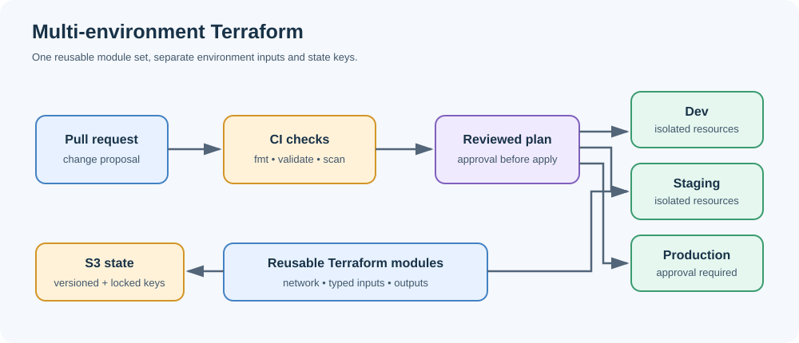
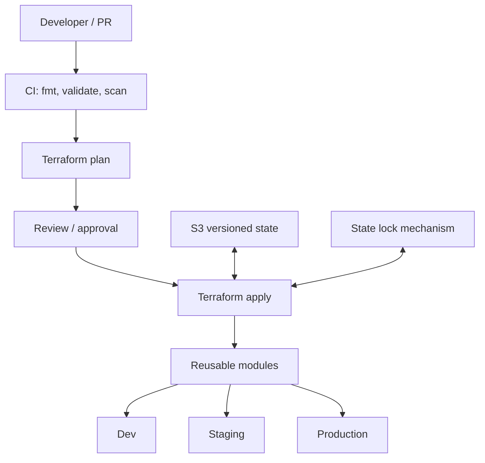

# 3. Multi-Environment Terraform Setup with Remote State and Modules

A reusable Infrastructure as Code foundation for dev, staging, and production-like environments, including remote state, locking, and policy checks.

> **Project status:** Starter implementation is included below. It provisions a VPC only; validate it in a sandbox before using it for shared or production infrastructure.

## Objectives

- Reuse Terraform modules across environments.
- Isolate environment inputs and state.
- Store state in S3 with encryption and versioning.
- Use S3 native state locking (`use_lockfile`) with Terraform 1.10 or later.
- Run formatting, validation, security, and policy checks in CI.

## Architecture





## Repository layout

```text
terraform-platform/
├── bootstrap/state/         # Creates the encrypted, versioned state bucket
├── infra/                   # Shared root; environment is selected by tfvars/backend key
│   └── environments/
├── modules/network/
├── .github/workflows/
└── README.md
```

Each environment uses its own backend key and variable file. This starter implements a VPC with public and isolated private subnet pairs; it intentionally does not create NAT gateways, compute, or security-group rules. Add those only when a workload needs them and after reviewing their cost and network exposure.

## Example module usage

```hcl
module "network" {
  source             = "../modules/network"
  name               = "${var.project_name}-${var.environment}"
  vpc_cidr           = var.vpc_cidr
  availability_zones = slice(data.aws_availability_zones.available.names, 0, var.az_count)
  tags               = var.tags
}
```

## S3 backend configuration

```hcl
terraform {
  backend "s3" {}
}
```

The included `infra/backend-*.hcl.example` files provide the bucket, environment-specific key, region, encryption, and native S3 locking settings. Terraform's backend block is in `infra/versions.tf`; the bucket itself is created separately by `bootstrap/state`.

## Run the starter

The commands below create AWS resources only when you run `terraform apply`. First set an AWS budget, configure an AWS profile with least-privilege permissions, and select the intended account. Do not commit copied `.tfvars` or backend files.

1. Create a unique bucket name that meets S3 naming rules. From the project root, initialize and review the bootstrap plan:

   ```powershell
   terraform -chdir=bootstrap\state init
   terraform -chdir=bootstrap\state plan -var="state_bucket_name=YOUR_GLOBALLY_UNIQUE_BUCKET"
   ```

2. After reviewing the plan and confirming the account, create the state bucket:

   ```powershell
   terraform -chdir=bootstrap\state apply -var="state_bucket_name=YOUR_GLOBALLY_UNIQUE_BUCKET"
   ```

   The bootstrap's Terraform state is initially local. Back it up and protect it; do not casually destroy the state bucket.

3. In `infra`, copy the matching `.tfvars.example` and `backend-*.hcl.example` to local files without the `.example` suffix. Replace the backend bucket placeholder with the bucket name created above. For example:

   ```powershell
   Copy-Item infra\environments\dev.tfvars.example infra\dev.tfvars
   Copy-Item infra\backend-dev.hcl.example infra\backend-dev.hcl
   Set-Location infra
   terraform init -backend-config=backend-dev.hcl
   terraform plan -var-file=dev.tfvars
   ```

   Review the full plan before applying. To create the network, run `terraform apply -var-file=dev.tfvars`; to remove that environment, review `terraform plan -destroy -var-file=dev.tfvars` before `terraform destroy -var-file=dev.tfvars`.

4. Repeat with the staging or production files only after changing their CIDRs, region, account, and approvals as needed. Each backend key is isolated. Never run two environments with the same backend key.

Terraform S3 backend access needs permissions for state objects and lock files in addition to permissions for the managed AWS resources. Configure those permissions for each operator/CI identity; do not use long-lived access keys in GitHub.

## CI quality gates

```bash
terraform fmt -check -recursive
terraform init -backend=false
terraform validate
tflint --recursive
tfsec .
checkov -d .
terraform plan
```

Use either tfsec/Checkov or another maintained scanner based on your requirements. Pin versions and review findings rather than blindly suppressing them.

## Implementation steps

1. Define naming, tagging, and module input/output conventions.
2. Build and validate the included network module.
3. Add compute/security modules only when a workload requires them, with least-privilege defaults.
4. Select dev/staging/prod through separate variable files and backend keys.
5. Create the remote state bucket with versioning, encryption, and restrictive bucket policy.
6. Configure CI to run fmt, validate, lint, and security checks on pull requests.
7. Require plan review and explicit approval for sensitive environments.
8. Test state locking with two concurrent operations in a disposable environment.
9. Test state recovery from an S3 object version.
10. Document import, migration, and disaster recovery procedures.

## Step-by-step build guide

Start with a low-risk sandbox account and Terraform 1.10 or later. Never commit state, credentials, backend files, or unreviewed plan files.

### Milestone 1: Build and test one module locally

1. Review `modules/network` and the input/tagging conventions in `infra`.
2. Initialize the root with `terraform init -backend=false` for local validation.
3. Use the dev variable file and review a plan before creating any resources.
4. Run `terraform fmt -check -recursive`, `terraform init -backend=false`, and `terraform validate`.
5. Review the plan before applying any cloud resources.

**Checkpoint:** The module can be called from dev, has documented inputs/outputs, and passes format/validate.

### Milestone 2: Add isolated environments

1. Use distinct dev, staging, and prod variable files and backend keys.
2. Confirm plans differ only where the environment inputs require them to differ.
3. Provision the dedicated S3 state bucket with encryption, versioning, and a restrictive policy; avoid storing application secrets in state.
4. Configure and test state locking using the selected Terraform/backend version.
5. Test recovery of a prior state object version in a disposable setup.

**Checkpoint:** The environments do not share state, and locking and state recovery have been tested.

### Milestone 3: Add CI quality gates

1. Run format, validation, lint, and a selected infrastructure scanner on pull requests.
2. Publish plan output for review while redacting sensitive values.
3. Require an explicit approval before applying changes to shared or production-like environments.
4. Confirm CI fails on a deliberately invalid configuration and does not apply on pull requests.

**Checkpoint:** A pull request shows a reviewable plan and blocks failed checks; apply is separately approved.

### Milestone 4: Exercise operations safely

1. Test concurrent state operations in an isolated environment to verify locking.
2. Test an import or a state migration only with a backup and a documented recovery path.
3. Review drift and apply only after understanding each proposed change.
4. Destroy disposable resources by environment after reviewing the destroy plan; retain shared state according to the recovery policy.

**Completion evidence:** Module example, environment plans, CI check results, locking test, state-version recovery test, and cleanup instructions.

## Validation checklist

- [ ] No credentials or state files are committed.
- [ ] Environment state keys are isolated.
- [ ] State bucket versioning and encryption are enabled.
- [ ] Locking behavior is verified for the Terraform version.
- [ ] Modules have documented inputs, outputs, and examples.
- [ ] CI blocks invalid formatting and failed validation.
- [ ] Security findings are reviewed and tracked.
- [ ] Production apply requires approval.

## Metrics

Track plan failure rate, policy violations, module reuse, drift findings, and time from reviewed change to successful apply. Report only values collected from pipeline history.

## Cleanup

Destroy disposable resources by environment, verify state first, and retain state-bucket versions according to your recovery policy. Never delete a shared state bucket as routine cleanup.

## Implemented files and scope

The starter includes:

- `bootstrap/state/`: S3 state bucket with versioning, server-side encryption, public-access blocking, and a TLS-only bucket policy.
- `modules/network/`: VPC, internet gateway, public subnets, isolated private subnets, and public routing.
- `infra/`: shared root configuration plus dev/staging/prod variable and backend examples.
- `.github/workflows/terraform.yml`: format and validation checks only; it does not access AWS or apply infrastructure.

The other six directories now also contain architecture images and safe starter files. This project is the foundation for the AWS projects; no AWS resources have been created by preparing these files.
