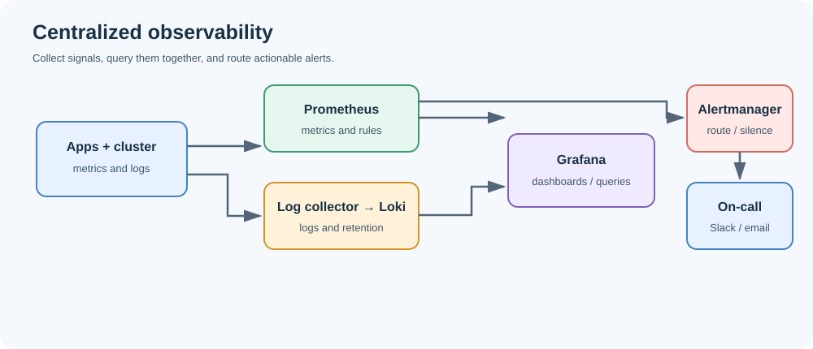
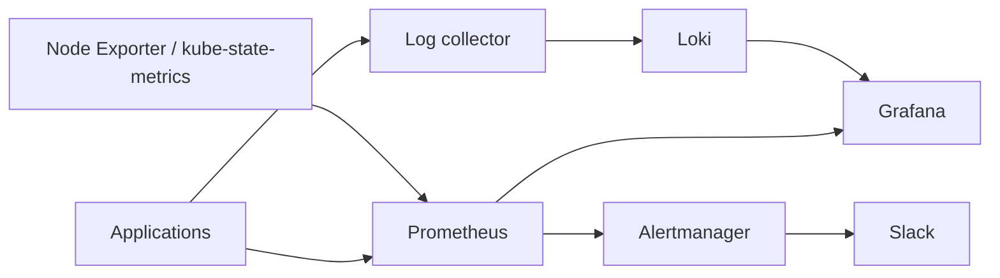

# 4. Centralized Observability Stack

A Kubernetes observability platform using Prometheus for metrics, Grafana for dashboards, Loki for logs, and Alertmanager for alert routing.

> **Project status:** Reference implementation. Add dashboard exports, alert screenshots, and measured SLO results after deploying and testing the stack.

## Objectives

- Collect cluster and application metrics.
- Centralize application/container logs.
- Build dashboards for availability, traffic, errors, latency, and saturation.
- Route actionable alerts to the correct Slack channel.
- Define service-level indicators (SLIs) and service-level objectives (SLOs).

## Architecture





## Technology stack

- Kubernetes / EKS, Helm
- Prometheus, kube-state-metrics, Node Exporter
- Grafana, Loki, Promtail or a supported log collector
- Alertmanager, Slack incoming webhook
- Optional: OpenTelemetry Collector and tracing backend

Check current compatibility and maintenance status of log agents before choosing a deployment chart.

## Suggested repository layout

```text
observability/
├── helm/
│   ├── values-prometheus.yaml
│   ├── values-grafana.yaml
│   └── values-loki.yaml
├── dashboards/
│   ├── cluster-overview.json
│   └── application-slo.json
├── alerts/
│   ├── application.rules.yaml
│   └── infrastructure.rules.yaml
├── runbooks/
└── README.md
```

Starter assets are provided in `prometheus/sample-api-rules.yaml` and `grafana/sample-api-dashboard.json`. The alert resource assumes Prometheus Operator CRDs and a matching scrape job label; adapt the namespace, `release` label, and metric labels to your Helm release and application before applying.

Import the dashboard JSON into Grafana after configuring a Prometheus data source. Apply the PrometheusRule only after confirming the Prometheus Operator CRDs are installed and that your Prometheus instance selects the rule's namespace and `release` label. The sample rule/dashboard depend on the `http_requests_total` metric and `job="sample-api"` label; change those to match your scrape configuration.

## Example Prometheus alert rule

```yaml
groups:
  - name: application
    rules:
      - alert: HighHttpErrorRate
        expr: |
          sum(rate(http_requests_total{status=~"5.."}[5m]))
          /
          clamp_min(sum(rate(http_requests_total[5m])), 1)
          > 0.05
        for: 5m
        labels:
          severity: warning
        annotations:
          summary: "HTTP 5xx rate is above 5%"
          runbook_url: "https://REPLACE_WITH_RUNBOOK_URL"
```

Adapt metric names and labels to the application instrumentation. Avoid alerting on metrics that do not exist.

## Implementation steps

1. Create a Kubernetes cluster or local test cluster.
2. Install the Prometheus stack using Helm.
3. Add application instrumentation and scrape configuration.
4. Install Loki and a compatible log collector.
5. Connect Prometheus and Loki as Grafana data sources.
6. Build dashboards for cluster and service health.
7. Configure Alertmanager receivers and Slack routing using Kubernetes Secrets.
8. Add runbook links, severity, ownership, and alert inhibition.
9. Trigger test alerts and verify delivery.
10. Test retention, storage growth, and recovery.

## Step-by-step build guide

Use a local Kubernetes cluster for the first pass if possible. Before collecting real data, decide retention, storage limits, access controls, and whether logs may contain sensitive information.

### Milestone 1: Collect a known metric

1. Deploy a sample app that emits request count, error count, and latency metrics.
2. Install the Prometheus stack using a pinned chart version and a small, reviewed values file.
3. Configure scraping and verify the target is up and the expected metric names are queryable.
4. Create a simple dashboard for request rate, errors, and latency.

**Checkpoint:** A generated test request appears in Prometheus and Grafana with the expected labels and values.

### Milestone 2: Centralize logs

1. Install Loki and a currently supported log collector compatible with the cluster.
2. Configure collection for the sample app and confirm logs can be queried by namespace and workload.
3. Check that logs do not expose credentials, tokens, or other sensitive values.
4. Configure retention and storage limits; verify disk use and behavior when storage fills.

**Checkpoint:** You can find a test request in logs and have a documented retention policy.

### Milestone 3: Alert and define service objectives

1. Create an alert from a metric that exists in your app; test the expression before routing notifications.
2. Configure Alertmanager and store the Slack webhook in a Kubernetes Secret or an approved secret manager.
3. Send a test alert, verify delivery, and ensure the webhook is not visible in repository history or logs.
4. Select SLIs and targets that fit the test service; label example targets as goals, not measured outcomes.
5. Add an owner, severity, and runbook link to every actionable alert.

**Checkpoint:** A controlled test triggers one useful alert, routes it to the right place, and includes actionable context.

### Milestone 4: Test operations

1. Stop or break a test workload and verify the dashboard/alert reflects the failure.
2. Restart or restore the workload and verify recovery.
3. Test restart/recovery of the observability components and document data-loss/retention behavior.
4. Add dashboard exports, representative PromQL/LogQL queries, and sanitized alert evidence.

**Completion evidence:** Dashboard, sample metric/log queries, test alert, retention configuration, and a short troubleshooting runbook.

## Example SLO design

| SLI | Example objective | Measurement |
|---|---|---|
| Availability | 99.5% over 30 days | Successful eligible requests / total eligible requests |
| Latency | 95% under 300 ms | p95 request latency |
| Error rate | Under 1% | Failed requests / total requests |
| Freshness | Metrics available within 2 minutes | Scrape/ingestion delay |

These are sample targets, not measured results. Choose targets based on service requirements.

## Useful commands

```bash
helm list -A
kubectl get pods -A
kubectl get servicemonitors -A
kubectl port-forward svc/<grafana-service> 3000:80 -n <namespace>
kubectl logs deploy/<alertmanager-deployment> -n <namespace>
```

## Security and operations

Keep Grafana behind authentication, store webhook URLs in Secrets, restrict access with RBAC, set retention limits, and monitor the monitoring stack itself. Persistent volumes and log ingestion can create significant storage costs.

## Evidence to add

Include Grafana dashboard JSON, representative PromQL and LogQL queries, test alert delivery, and a short incident runbook.
