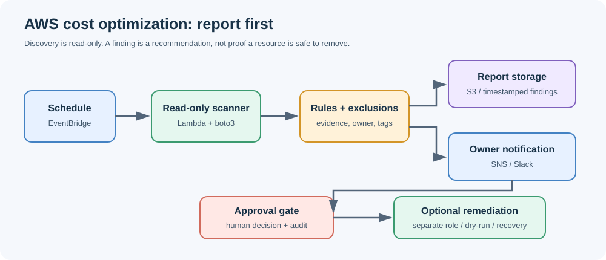
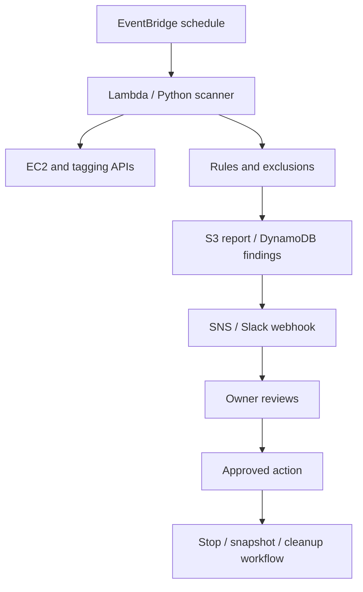

# 5. AWS Cost Optimization Automation

A cost-governance project that discovers potentially idle or unattached AWS resources, applies safe tagging, estimates potential savings, and sends a report to Slack or email.

> **Project status:** Build guide. Start in report-only mode. Do not automatically stop or delete resources until ownership, exclusions, and approval controls are implemented.

## Objectives

- Identify candidate idle EC2 instances, unattached EBS volumes, and unused Elastic IPs.
- Apply or recommend standard cost-allocation tags.
- Estimate monthly cost using current pricing data or Cost Explorer; label estimates clearly.
- Notify owners with resource IDs, evidence, and recommended action.
- Require approval for disruptive actions.

## Architecture





## Technology stack

- AWS Lambda, EventBridge, IAM
- Python + boto3
- EC2 APIs, Cost Explorer (optional)
- S3 for reports, SNS or Slack for notifications
- CloudWatch Logs and alarms
- Terraform for deployment

## Suggested repository layout

```text
aws-cost-optimizer/
├── src/
│   ├── scanner.py
│   ├── rules.py
│   ├── pricing.py
│   └── notifier.py
├── tests/
├── infra/
├── config/
│   └── exclusions.yaml
├── docs/
└── README.md
```

## Detection policy examples

| Resource | Candidate rule | Safe next step |
|---|---|---|
| EC2 | Low average CPU/network over a defined window | Notify owner; verify workload schedule |
| EBS | Unattached volume | Check snapshots, age, tags, and owner |
| Elastic IP | Not associated with a running resource | Confirm not reserved for failover |
| EBS snapshots | Older than retention policy | Review backup/compliance requirements |

Low CPU alone does not prove an instance is unused. Use multiple signals and exclusions for production, databases, recovery, and scheduled workloads.

## Example read-only EC2 discovery

```python
import boto3

ec2 = boto3.client("ec2")

def find_stopped_instances():
    paginator = ec2.get_paginator("describe_instances")
    for page in paginator.paginate(
        Filters=[{"Name": "instance-state-name", "Values": ["stopped"]}]
    ):
        for reservation in page.get("Reservations", []):
            for instance in reservation.get("Instances", []):
                yield {
                    "instance_id": instance["InstanceId"],
                    "state": instance["State"]["Name"],
                    "tags": {t["Key"]: t["Value"] for t in instance.get("Tags", [])},
                }

if __name__ == "__main__":
    for item in find_stopped_instances():
        print(item)
```

This sample is read-only and intentionally does not stop or terminate resources.

### Run the starter scanner

The implementation in `src/scanner.py` only lists stopped EC2 instances and writes a CSV recommendation; it does not mutate AWS resources or calculate savings. From this directory:

```powershell
py -m venv .venv
.\.venv\Scripts\Activate.ps1
python -m pip install -r requirements.txt
python -m pytest -q
python src\scanner.py --region ap-south-1 --output findings.csv
```

Use an AWS CLI profile/role with read-only EC2 permissions. Do not add access keys to source files or command history. API and credential errors stop execution rather than producing a misleading empty-success report.

## Implementation steps

1. Define allowed AWS accounts/regions and a mandatory exclusion-tag convention.
2. Create a least-privilege IAM role with read-only discovery permissions.
3. Implement paginated discovery and unit tests using mocked AWS responses.
4. Add configurable rules, age thresholds, and owner resolution.
5. Store timestamped findings and evidence in S3.
6. Generate a report with resource ID, region, owner, reason, and confidence.
7. Add cost estimates with source/date and clear assumptions.
8. Send Slack/SNS notifications.
9. Add an approval workflow for any action that changes resource state.
10. Run in report-only mode for multiple weeks and review false positives.

## Step-by-step build guide

Keep the first version strictly read-only. Cost and usage data can be delayed, and a low-activity resource may still be important. Do not implement stop/delete automation until report quality, ownership, exclusions, and approvals have been exercised.

### Milestone 1: Define policy and permissions

1. Choose one sandbox account and a small set of regions.
2. Define required owner, environment, and cost-center tags, plus explicit exclusion tags.
3. Create a least-privilege read-only role for the resource types in scope.
4. Add configuration validation and unit tests for missing tags, excluded resources, and region boundaries.

**Checkpoint:** The scanner cannot mutate AWS resources and has clear scope/exclusion rules.

### Milestone 2: Implement discovery and reporting

1. Implement paginated discovery for one resource type first; normalize IDs, tags, account, and region.
2. Add mocked API tests for empty pages, multiple pages, missing tags, and API errors.
3. Add one candidate rule with evidence and explain why it is only a recommendation.
4. Produce a timestamped CSV or JSON report with owner, evidence window, recommendation, and estimate source.
5. Make the script fail visibly on discovery/reporting errors rather than silently returning an empty success report.

**Checkpoint:** Repeatable tests produce a report from mocked responses, and a sandbox run produces a reviewable report without changing resources.

### Milestone 3: Add scheduled execution and notifications

1. Package the scanner for Lambda and schedule it with EventBridge.
2. Store reports in a restricted S3 location and configure retention.
3. Send findings through SNS or a secret-managed Slack integration.
4. Add CloudWatch logs/alarms for failed runs and avoid logging sensitive account details beyond what operations require.
5. Verify the scheduled run, report permissions, notification, and failure alarm.

**Checkpoint:** A scheduled, read-only run generates an auditable report and alerts an operator if it fails.

### Milestone 4: Measure quality before remediation

1. Run report-only for multiple weeks and have owners classify findings as valid, false positive, or exempt.
2. Track false positives, confirmed candidates, tag coverage, and time to owner decision.
3. Compare cost estimates to an authoritative billing source and record estimate assumptions and date.
4. If adding a remediation workflow later, require explicit approval, dry-run output, audit logging, and a recovery plan for each action type.

**Completion evidence:** Tests, least-privilege policy, sanitized sample report, scheduled run, false-positive review, and estimate methodology. Report realized savings only after confirming them in billing data.

## Example report fields

`account_id, region, resource_type, resource_id, owner, finding, evidence_window, estimated_monthly_saving, estimate_source, recommendation, approval_status`

## Security and safety

Use read-only permissions for discovery. Separate discovery from remediation roles. Never hardcode credentials or webhook URLs. Require approval, audit logging, and rollback/recovery plans for stop/delete operations.

## Metrics

- Candidate resources found
- Confirmed unused resources
- False-positive rate
- Estimated vs. realized monthly savings
- Time from finding to owner decision
- Percentage of resources with owner/cost-center tags

Do not claim “saved $X/month” until billing data confirms realized savings over a comparable period.
