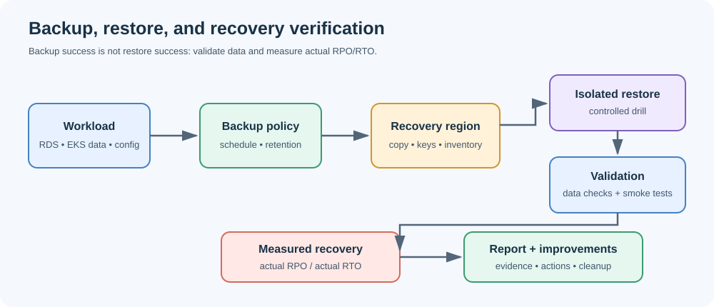
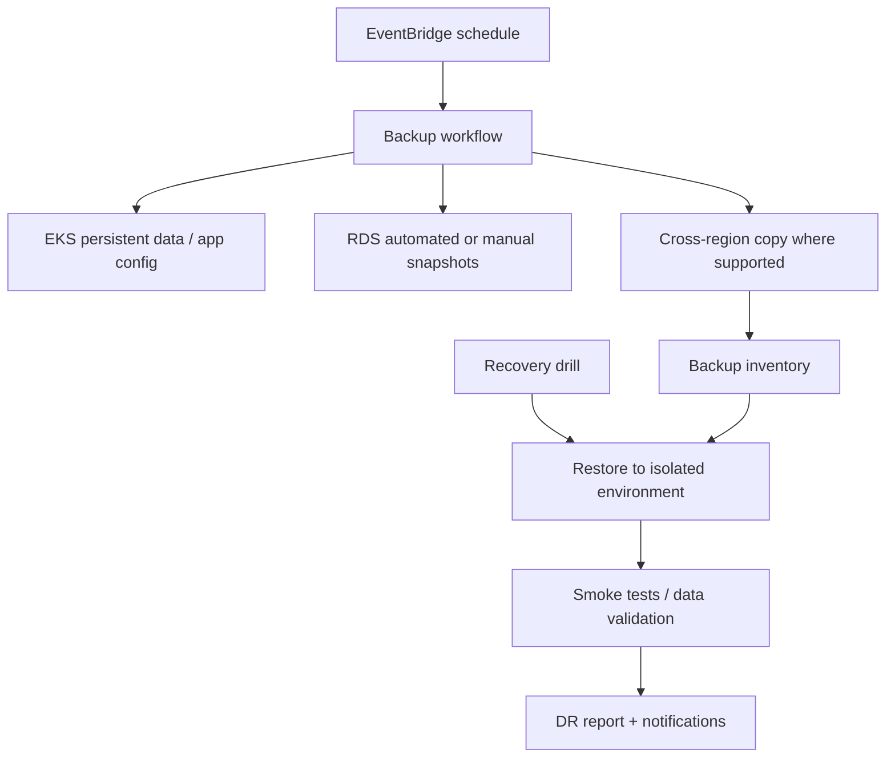

# 6. Disaster Recovery and Backup Automation

A reliability engineering project that automates backup verification and rehearses recovery for selected AWS workloads, including EKS and RDS.

> **Project status:** Reference design. A backup is not proven usable until a restore test succeeds. Run recovery drills only in an isolated environment with approved data handling.

## Objectives

- Define recovery point objective (RPO) and recovery time objective (RTO).
- Automate scheduled backups and retention checks.
- Copy supported backups/snapshots to a recovery region.
- Restore into an isolated environment and run validation tests.
- Produce an auditable drill report and runbook.

## Architecture





## Technology stack

- AWS Backup, RDS snapshots, S3 versioning/replication as appropriate
- EKS manifests/Helm/GitOps for cluster configuration
- EventBridge, Lambda or Step Functions
- CloudWatch, SNS/Slack
- Terraform, Python/boto3

## Suggested repository layout

```text
aws-disaster-recovery/
├── infra/
├── backup-policies/
├── scripts/
│   ├── inventory.py
│   ├── verify-backups.py
│   └── restore-drill.py
├── runbooks/
│   ├── rds-restore.md
│   └── eks-recovery.md
├── tests/
└── README.md
```

## Recovery design

1. Identify critical services, data stores, dependencies, and owners.
2. Set RPO/RTO per service and document assumptions.
3. Define backup frequency, retention, encryption, and cross-region requirements.
4. Back up database data using service-supported mechanisms.
5. Store application configuration and Kubernetes manifests in version control.
6. Restore into a separate recovery environment with restricted network access.
7. Validate database consistency, application health, and access controls.
8. Record actual recovery duration and data-loss window.
9. Review gaps and update runbooks.

## Step-by-step build guide

Perform drills only in an approved, isolated environment. Restores can expose sensitive data and create significant temporary charges. Confirm data-handling approval, encryption-key access, and cleanup ownership before each drill.

### Milestone 1: Define recovery requirements

1. Select one non-production workload and identify its database, persistent data, configuration, identity, and network dependencies.
2. Agree on a target RPO and RTO with the service owner; state assumptions about workload size and dependencies.
3. Choose the supported backup method for each data type and define retention, encryption, and region requirements.
4. Write a restore checklist before automating backups.

**Checkpoint:** The service owner approves the scope, target objectives, and recovery test plan.

### Milestone 2: Back up and verify inventory

1. Configure scheduled backups and retention using the chosen AWS service.
2. Enable cross-region copy only where required and supported; verify destination permissions and encryption keys.
3. Build an inventory report with resource, backup timestamp, region, retention status, and job status.
4. Alert on missing or stale backups and test the alert with a controlled condition.

**Checkpoint:** A recent recovery point is visible in the expected region and its encryption/access requirements are documented.

### Milestone 3: Run an isolated restore drill

1. Create a temporary recovery environment with restricted network access and a clear naming/tagging convention.
2. Restore the selected backup and record start/end timestamps.
3. Run data consistency checks and application smoke tests; do not treat a successful backup job as proof of recoverability.
4. Measure the recoverable data point and end-to-end restoration time against the agreed RPO/RTO.
5. Remove temporary resources after validation and approval.

**Checkpoint:** The restored service passes validation, measured RPO/RTO are recorded, and temporary resources are accounted for.

### Milestone 4: Automate, document, and improve

1. Automate inventory and verification first; automate restore only after the manual runbook is reliable.
2. Store drill results with timestamps, test version, backup identifier, validation outcome, and sanitized evidence.
3. Document key-access failures, missing dependencies, and operator decisions.
4. Track corrective actions and repeat the drill after fixes.

**Completion evidence:** Approved recovery plan, backup inventory, successful restore test, measured RPO/RTO, sanitized logs, and cleanup record.

## Example recovery drill checklist

- [ ] Approved change/drill window and responsible operator assigned.
- [ ] Latest backup timestamp and retention verified.
- [ ] Encryption key access tested in recovery region.
- [ ] Restore target is isolated and correctly sized.
- [ ] Application configuration and secrets can be recovered securely.
- [ ] Data validation and smoke tests pass.
- [ ] RTO and RPO are measured and recorded.
- [ ] Temporary resources are removed after approval.
- [ ] Drill findings and corrective actions are documented.

## Run the backup inventory starter

`src/backup_inventory.py` lists AWS Backup jobs for a chosen region and lookback window and writes a CSV. It is read-only; it does not create, copy, or restore backups.

```powershell
py -m venv .venv
.\.venv\Scripts\Activate.ps1
python -m pip install -r requirements.txt
python -m pytest -q
python src\backup_inventory.py --region ap-south-1 --hours 168 --output backup-jobs.csv
```

Use a role with read-only AWS Backup permissions. A job listed as completed is not proof that its recovery point can be restored; follow the restore-drill steps above.

## Metrics

| Metric | Meaning |
|---|---|
| RPO achieved | Actual recoverable data point vs. target |
| RTO achieved | Actual time to restore service vs. target |
| Backup success rate | Successful backup jobs / scheduled jobs |
| Restore success rate | Successful restore tests / attempted tests |
| Backup age | Time since last verified recovery point |

## Operational cautions

Cross-region copies, snapshots, backup storage, data transfer, and restored compute can incur charges. Protect backups from accidental deletion, restrict restore permissions, and test key access. EKS control-plane configuration is not a substitute for backing up persistent application data.

## Evidence to add

Publish a sanitized recovery runbook, backup inventory, restore-test logs, measured RPO/RTO, and post-drill action list.
