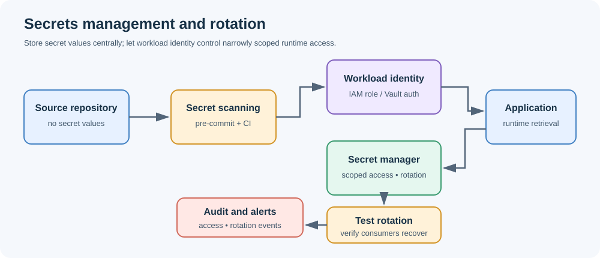
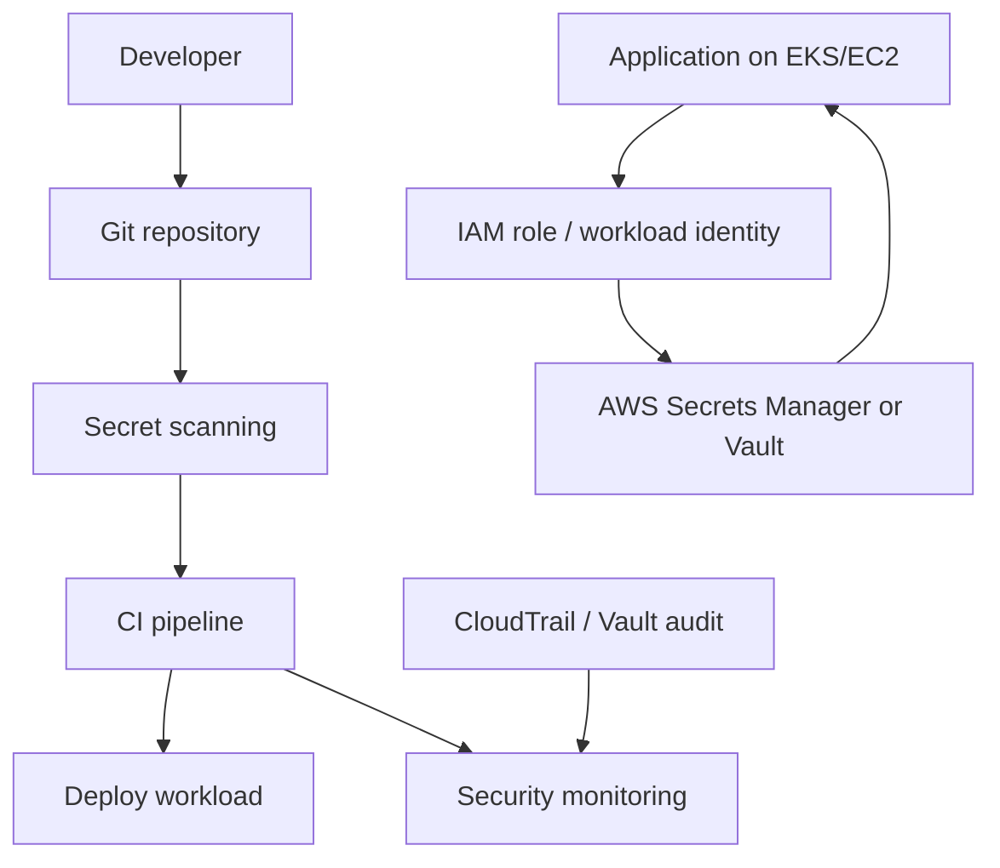

# 7. Secrets Management Overhaul

A security-focused project to remove hardcoded credentials from application code and CI/CD configuration, centralize secret storage, and establish controlled access and rotation.

> **Project status:** Implementation blueprint. Never commit real credentials, sample production secrets, or secret values in screenshots.

## Objectives

- Find and remove secrets from source code and pipeline variables.
- Store runtime secrets in AWS Secrets Manager or HashiCorp Vault.
- Grant workloads access through IAM roles / workload identity.
- Integrate secret references into Terraform and CI/CD without exposing values.
- Rotate credentials and audit access.

## Architecture





## Technology stack

- AWS Secrets Manager or HashiCorp Vault (select one for the first implementation)
- IAM roles for service accounts / EKS Pod Identity, where appropriate
- Terraform, Kubernetes External Secrets or Secrets Store CSI Driver
- GitHub Actions/GitLab CI, secret scanning
- CloudTrail or Vault audit devices

## Suggested repository layout

```text
secrets-management/
├── app/
├── infra/
│   ├── iam/
│   └── secret-metadata/
├── k8s/
│   └── secret-store-config/
├── .github/workflows/
├── scripts/
│   └── rotation-check.py
├── runbooks/
└── README.md
```

## Implementation steps

1. Inventory credentials and identify owners, consumers, and rotation impact.
2. Revoke exposed credentials immediately; deleting them from Git history alone is insufficient.
3. Create a central secret store and define naming, tagging, and ownership conventions.
4. Configure least-privilege IAM access for each application identity.
5. Integrate runtime retrieval or a supported Kubernetes secret-sync mechanism.
6. Add secret scanning to pre-commit and CI.
7. Configure rotation for supported credentials and test application reconnection.
8. Enable audit logging and alert on unusual access.
9. Document emergency revocation and recovery procedures.
10. Verify no secret values appear in logs, build artifacts, manifests, or repository history.

## Step-by-step build guide

Use test credentials in a sandbox. If you discover a real exposed credential, treat it as compromised and coordinate revocation/rotation with its owner; deleting the text from the current branch does not invalidate it or remove it from history.

### Milestone 1: Inventory and scan

1. Choose AWS Secrets Manager or Vault for the first version and record why.
2. Inventory test credentials, consumers, owners, permissions, and rotation constraints.
3. Add secret scanning to local checks and CI, with narrow, reviewed allowlists.
4. Test the scanner using a fake, nonfunctional test string and verify it flags the sample without publishing real credentials.

**Checkpoint:** Findings are assigned to owners, scanner behavior is verified, and no real secret values are placed in test evidence.

### Milestone 2: Store and authorize secrets

1. Create secret metadata and naming/tagging conventions; keep secret values out of Terraform configuration and outputs.
2. Configure a workload identity for the sample app (IAM role/workload identity or Vault auth).
3. Grant access only to the required secret and verify an unrelated identity is denied.
4. Enable audit logging and confirm access events can be found without exposing secret values.

**Checkpoint:** The app identity can read only the intended test secret, and access is auditable.

### Milestone 3: Integrate runtime retrieval

1. Choose runtime SDK retrieval or a supported Kubernetes integration.
2. Configure the app to read the test secret without logging it or embedding it in an image, manifest, or build artifact.
3. Verify startup and reconnection behavior after a test secret update.
4. Test denied access and missing-secret behavior; surface clear errors without falling back to an insecure default.

**Checkpoint:** The app uses managed secret storage at runtime and handles access/rotation failures safely.

### Milestone 4: Rotate and operate

1. Configure rotation for a supported test credential and plan for consumers that need reconnection.
2. Exercise a rotation end-to-end, verify the old credential is rejected where appropriate, and record recovery steps.
3. Add alerts for rotation failures and unusual access.
4. Document emergency revocation, break-glass access, and incident ownership.
5. Scan source, manifests, logs, build artifacts, and repository history; rotate anything that may have been exposed.

**Completion evidence:** Sanitized policy/configuration, scanner result, authorized/denied access tests, rotation test, audit event, and emergency runbook.

## Example Terraform metadata resource (AWS Secrets Manager)

```hcl
resource "aws_secretsmanager_secret" "app" {
  name                    = "demo/application/database"
  description             = "Metadata for the demo application's database credential"
  recovery_window_in_days = 7

  tags = {
    Environment = "dev"
    ManagedBy   = "terraform"
  }
}
```

Keep secret values out of Terraform source and avoid passing sensitive values through outputs or state unless the state security model explicitly accounts for them. Terraform state can contain sensitive data.

### Starter files and local test

The `infra/` starter creates AWS Secrets Manager metadata and attaches a narrowly scoped read policy to an existing workload IAM role. It does not create or populate a secret value. The `app/secret_reader.py` sample retrieves a JSON secret at runtime and reports only the number of fields; it does not print the values.

```powershell
py -m venv .venv
.\.venv\Scripts\Activate.ps1
python -m pip install -r app\requirements.txt
python -m pytest -q app
```

Before any Terraform apply, create the workload role separately, review the plan, and set `secret_name` and `workload_role_name`. Provision a test value out of band using an approved secret-management process; do not put it in `.tfvars`, Terraform state, or shell history. No AWS resources are created by running the local tests.

## Example secret scanning

```bash
# Example with Gitleaks installed
gitleaks detect --source . --redact --no-git
```

Pin the scanner version and configure allowlists narrowly. Treat every detected credential as potentially exposed until verified otherwise.

## Security checklist

- [ ] All identified exposed credentials are revoked/rotated.
- [ ] Runtime access uses workload identity, not static AWS keys.
- [ ] IAM policies scope access to required secret ARNs.
- [ ] Secret values are not printed in logs or CI output.
- [ ] Secret scanning runs on pull requests and default branch.
- [ ] Rotation is tested end-to-end.
- [ ] Audit events are retained and reviewed.
- [ ] Break-glass access is restricted and monitored.

## Metrics

Track hardcoded-secret findings, time to revoke exposed credentials, rotation success rate, age of credentials, denied/unauthorized access attempts, and percentage of workloads using identity-based access.

## Evidence to add

Include sanitized IAM policy examples, secret-scanning pipeline output, rotation test evidence, audit-event examples with values redacted, and an emergency rotation runbook.
